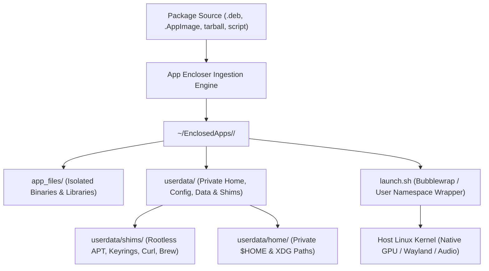

<div align="center">

# App Encloser

### Native Linux Application Sandbox, Package Encloser & Runtime Universe

[](https://ubuntu.com)
[](https://python.org)
[](https://gnome.org)
[-FF6F00?style=for-the-badge&logo=linuxcontainers&logoColor=white)](https://github.com/containers/bubblewrap)
[](https://modelcontextprotocol.io)
[](LICENSE)

<br/>

**App Encloser** encapsulates **any** Linux application package (`.deb`, `.AppImage`, `.tar.gz`, `.zip`, `.rpm`, `.jar`, or arbitrary terminal install scripts) into an isolated, self-contained, portable directory inside `~/EnclosedApps/<AppName>/`.

Zero background daemons. Zero root requirement. Instant native performance. 100% zero-residual uninstallation.

</div>

---

## Table of Contents

- [Overview & Why App Encloser?](#overview--why-app-encloser)
- [Comparison Matrix](#comparison-matrix)
- [Key Features](#key-features)
  - [Three Enclosing Isolation Profiles](#three-enclosing-isolation-profiles)
  - [The Container Universe Experience](#the-container-universe-experience)
  - [Terminal & AI Agent Guard](#terminal--ai-agent-guard)
  - [Automated Anomaly Detection & Self-Repair](#automated-anomaly-detection--self-repair)
  - [Built-in MCP Server for AI Coding Agents](#built-in-mcp-server-for-ai-coding-agents)
- [Directory Architecture](#directory-architecture)
- [Installation & Setup](#installation--setup)
- [Command-Line Interface (CLI)](#command-line-interface-cli)
- [Philosophy & Human Disclaimer](#philosophy--human-disclaimer)
- [Verification & Automated Tests](#verification--automated-tests)
- [Contributing](#contributing)
- [License](#license)

---

## Overview & Why App Encloser?

Linux packaging has traditionally forced users to choose between system pollution and container bloat:

1. **System Package Managers (APT, DNF):** Installing third-party PPAs, `.deb` packages, or running piped install scripts (`curl | bash`) often overwrites system shared libraries, pollutes global paths, or leaves orphaned files scattered across `/etc`, `/usr`, `/var`, and `~/.config`.
2. **Flatpak & Snap:** Require upstream maintainers to build and publish dedicated manifests. They enforce rigid runtime dependencies, consume hundreds of megabytes of duplicate base runtimes, or require root background daemons.
3. **Docker & Podman:** Designed for server services, requiring heavy base images (500MB - 2GB), complex GPU/Wayland socket forwarding hacks, and high memory overhead.

**App Encloser solves this completely.** It uses Linux user namespaces and **Bubblewrap** (`bwrap`) to enclose arbitrary software directly into a lightweight, portable folder.



---

## Comparison Matrix

| Feature | App Encloser | Flatpak | Snap | Docker / Podman | Distrobox |
| :--- | :---: | :---: | :---: | :---: | :---: |
| **Ingest Any Raw Package / Script** | **Direct (.deb, tar, zip, sh)** | Manifest required | Snapcraft required | Dockerfile required | Container image |
| **Root Background Daemon** | **None (0 MB)** | None | Yes (`snapd`, ~200MB) | Yes (`dockerd`) | Host daemon |
| **Startup Overhead** | **Instant native (Standard) / ~20-50 ms (Strict bwrap)** | 50-200 ms | 200-800 ms (squashfs loop) | 300-1000 ms | 200-800 ms |
| **Storage Portability** | **Single folder per app** | Split in `~/.var` | Split in `~/snap` | Docker volumes | Container storage |
| **100% Zero-Residual Wipe** | **Instant (Delete folder)** | Leaves config | Leaves revisions | `docker prune` | Container removal |
| **AI Agent Guard (Exit Code 2)** | **Built-in (Opt-in)** | None | None | None | None |
| **Isolated Multi-Python / Brew** | **Built-in** | Complex | Difficult | Separate container | Full OS image |

---

## Key Features

### Three Enclosing Isolation Profiles

App Encloser provides three configurable isolation profiles per application:

1. **Standard Isolated (Default):**
   - Redirects `$HOME`, `$XDG_CONFIG_HOME`, `$XDG_DATA_HOME`, `$XDG_CACHE_HOME`, and `$TMPDIR` into the application's `userdata/` folder.
   - Applications see and use system libraries without polluting the user's home directory.
2. **Strict Sandbox (Bubblewrap Virtualization):**
   - Spawns unprivileged user namespaces via Bubblewrap (`bwrap`).
   - Mounts the host root filesystem strictly read-only (`--ro-bind / /`), protecting system binaries and configuration from unauthorized tampering.
   - Masks the real host home directory with an isolated `tmpfs` layer.
   - Preserves Wayland/X11 and PulseAudio/PipeWire sockets for native desktop integration.
   - Binds the container's directory read-write, strictly preventing modifications outside `~/EnclosedApps/<AppName>/`.
3. **System Integrated:**
   - For system utilities, daemons, or network tools (e.g. VPNs) that require direct host visibility while maintaining centralized container management.

---

### The Container Universe Experience

Every enclosed container acts as its own self-contained environment:

- **Interactive Shell:** Launching `app-encloser shell <app>` opens a dedicated container terminal with a custom colored prompt: `[Universe: <app>] ~$`.
- **Rootless APT & Package Swapping:** Run `sudo apt install <pkg>` or `sudo apt install <pkg>=<version>` inside the container. Package dependencies are downloaded and extracted into `app_files/` without touching the host system.
- **Rootless Keyring Redirection:** Transparently intercepts `/etc/apt/keyrings` and `/usr/share/keyrings` and routes them to `userdata/keyrings/`.
- **`encloser-python <version>`:** Download and use isolated Python versions (e.g. Python 3.10, 3.11, 3.12) inside that specific container without interfering with host Python.
- **`encloser-brew install <pkg>`:** Containerized Homebrew installation isolated in `userdata/linuxbrew/`.

---

### Terminal & AI Agent Guard

When enabled (opt-in via Settings or `app-encloser guard enable`), App Encloser configures an intelligent interceptor script (`~/.config/app-encloser/shell_guard.sh`):

- **Human Terminal Protection:** If you run `sudo apt install`, `pip install`, `npm install -g`, or `curl | bash`, the terminal presents an interactive menu offering to enclose the application cleanly into `~/EnclosedApps/` instead of polluting the host OS.
- **Autonomous AI Agent Interceptor:** Non-interactive environments and AI agent processes (Claude Code, Cursor, Aider, Copilot CLI, etc.) are detected via environment signals. Unsafe host modifications are intercepted with **Exit Code 2** and a structured instruction message directing the agent to use `app-encloser install <pkg>`.

---

### Automated Anomaly Detection & Self-Repair

App Encloser features an automated diagnostic and self-healing engine:

- Proactively audits containers for missing or non-executable shims (`apt`, `gpg`, `curl`, `wget`, `tee`, `sudo`, `nft`, `encloser-install`, `encloser-python`, `encloser-brew`).
- Cleans dead PIDs from `running.pid`.
- Restores executable bits on `launch.sh` and regenerates damaged `.desktop` files.
- Automatically self-heals corrupted JSON configuration files (`settings.json`, `install_history.json`) by backing up `.corrupt` copies and restoring valid schemas without throwing unhandled exceptions.
- Run manually at any time via:
  ```bash
  app-encloser doctor
  ```

---

### Built-in MCP Server for AI Coding Agents

App Encloser includes a native [Model Context Protocol (MCP)](https://modelcontextprotocol.io) server implementation operating over JSON-RPC 2.0 (stdio):

```bash
app-encloser --mcp
```

AI assistants can directly inspect container states, install packages safely into isolated containers, terminate rogue processes, and query application diagnostics without root access.

---

## Directory Architecture

Enclosed applications are structured as follows:

```text
~/EnclosedApps/<AppName>/
├── app_files/          # Extracted application binaries, libraries & assets
│   ├── usr/
│   ├── opt/
│   └── etc/
├── userdata/           # Isolated user state, home, and container shims
│   ├── shims/          # Rootless shims (apt, gpg, curl, wget, tee, sudo, etc.)
│   ├── home/           # Private $HOME directory
│   ├── config/         # Private $XDG_CONFIG_HOME
│   ├── local_share/    # Private $XDG_DATA_HOME
│   ├── cache/          # Private $XDG_CACHE_HOME
│   ├── tmp/            # Private $TMPDIR
│   ├── keyrings/       # Isolated APT repository keyrings
│   ├── etc_apt/        # Isolated APT sources lists
│   ├── venv/           # Optional per-container Python virtual environment
│   └── linuxbrew/      # Optional per-container Homebrew installation
├── icon.png            # High-resolution application icon
├── <AppName>.desktop   # Local desktop launcher entry
└── launch.sh           # Container execution script (with Bubblewrap sandbox)
```

---

## Installation & Setup

### Prerequisites (Ubuntu 24.04 LTS / Debian 12+)

Install system dependencies:

```bash
sudo apt-get update
sudo apt-get install -y \
    python3 \
    python3-gi \
    python3-gi-cairo \
    gir1.2-gtk-4.0 \
    gir1.2-adw-1 \
    bubblewrap \
    binutils \
    tar \
    gzip \
    xz-utils
```

### Option A: Install via Debian Package (.deb)

```bash
sudo dpkg -i app-encloser_1.0.1_all.deb || sudo apt-get install -f -y
```

### Option B: Build & Install from Source

```bash
git clone https://github.com/mdsrresad/app-encloser.git
cd app-encloser
./build.sh
```

The build script automatically compiles the rootless preload shim (`libencloser_shim.so`), generates the Debian package, and installs the executable into `~/.local/bin/app-encloser`.

---

## Command-Line Interface (CLI)

```bash
# Launch the GTK4 / Libadwaita graphical interface
app-encloser

# Enclose a local package, URL, or install script into a container
app-encloser install /path/to/app.deb
app-encloser install https://example.com/software.tar.gz
app-encloser install "curl -fsSL https://get.docker.com | sh"

# Install a package directly into an existing container
app-encloser install-into <AppName> <PackageName>

# Open an interactive terminal shell inside a container universe
app-encloser shell <AppName>

# Execute a command inside a container
app-encloser run <AppName> python3 --version

# Run diagnostic self-healing across all containers
app-encloser doctor

# Force stop running container processes
app-encloser kill <AppName>

# Inspect container contents, libraries, and active PIDs
app-encloser inspect <AppName>

# View or change isolation level (standard, strict, integrated)
app-encloser level <AppName> strict

# Audit all container and host installations
app-encloser audit

# Completely uninstall an application (100% zero-residual wipe)
app-encloser uninstall <AppName>

# Launch the Model Context Protocol (MCP) server for AI assistants
app-encloser --mcp
```

---

## Philosophy & Human Disclaimer

App Encloser is an independent personal open-source project authored and maintained with care, designed to give Linux users full control over application isolation and host system purity.

### A Note on Human Fallibility:
> **"Never blindly believe anything."**
> I am human, and humans can make mistakes. While App Encloser is engineered to high standards with strict verification, zero speculation, and 31 automated test suites, software interacts with complex operating system layers, diverse packaging formats, and evolving desktop environments.

- **Inspect and Verify:** Always inspect commands, verify scripts, and test in your own environment. Never execute arbitrary scripts from untrusted sources.
- **Feedback & Community:** If you discover a bug, an edge case, or an opportunity for improvement, issues and pull requests are welcomed. Every contribution helps make application isolation safer and more dependable.

---

## Verification & Automated Tests

App Encloser is verified by 31 comprehensive automated test suites:

```bash
python3 tests/verify_all.py
```

```text
================================================================
 App Encloser Automated Test & Verification Suite
================================================================
[✓ PASS] 1. Dynamic Metadata & Vector Monogram Generation
[✓ PASS] 2. Container Lifecycle & 100% Zero-Residual Wipe
[✓ PASS] 3. Canonical Desktop Launcher & Zero Duplicates
[✓ PASS] 4. Self-Uninstall Engine & Safety Verification
[✓ PASS] 5. Preferences & Installation Scope Engine
[✓ PASS] 6. MCP Server Protocol (JSON-RPC 2.0 initialize & Tools)
[✓ PASS] 7. CLI Interface & Self-Uninstall Flag Support
[✓ PASS] 8. Force Stop / Kill & Container Inspection Engine
[✓ PASS] 9. Granular Cache & User Data Reset Verification
[✓ PASS] 10. Error, Crash & Incompatibility Diagnosis Engine
[✓ PASS] 11. Debian Package Build & Binary Verification
[✓ PASS] 12. Container-Level Package Ingestion & In-Container Helpers
[✓ PASS] 13. Enclosing Isolation Levels & Non-Broken-Pipe Engine
[✓ PASS] 14. Installation History, Command Recipe Tracking & Host Audit
[✓ PASS] 15. Window Close Geometry & Dimension Saving
[✓ PASS] 16. Per-Container Python/Runtime Isolation & Bwrap Tmpfs
[✓ PASS] 17. Host Terminal Package Discovery & Multi-Source Purge
[✓ PASS] 18. OS Protection Filters & Host Purge Safeguards
[✓ PASS] 19. Audit Dialog Re-population Stability & Markup Escaping
[✓ PASS] 20. Recursive Subdirectory Icon Scoring & Monogram Auto-Upgrade
[✓ PASS] 21. Embedded encloser-install Syntax & Indentation Integrity
[✓ PASS] 22. Multi-Line Repo Script Inference & Rootless Keyring Shims
[✓ PASS] 23. CLI Usage Diagnostic & Strict Isolation Level Preservation
[✓ PASS] 24. OS Baseline Lock & Reverse-Dependency Safety Analyzer
[✓ PASS] 25. Scope Filtering (Recent & Heavy) & Live RAM Metrics
[✓ PASS] 26. /usr/bin/install Disaster Prevention & Clean History Records
[✓ PASS] 27. Container Universe Shims & Non-Self-Recursive Execution
[✓ PASS] 28. Ollama, Claude CLI & Homebrew Detection, Wipe & Migration
[✓ PASS] 29. Terminal Install Interceptor & AI Agent Guard Engine
[✓ PASS] 30. Interactive User Guide Dialog & Sub-Millisecond Polling
[✓ PASS] 31. Automated Container Anomaly Detection & Self-Repair Engine
================================================================
 ALL 31 VERIFICATION TEST SUITES PASSED (100% SUCCESS)
================================================================
```

---

## Contributing

Contributions, bug reports, and feature requests are welcome! Please check out [CONTRIBUTING.md](CONTRIBUTING.md) for guidelines on development and submitting pull requests.

---

## License

This project is licensed under the **MIT License**. See the [LICENSE](LICENSE) file for complete details.
