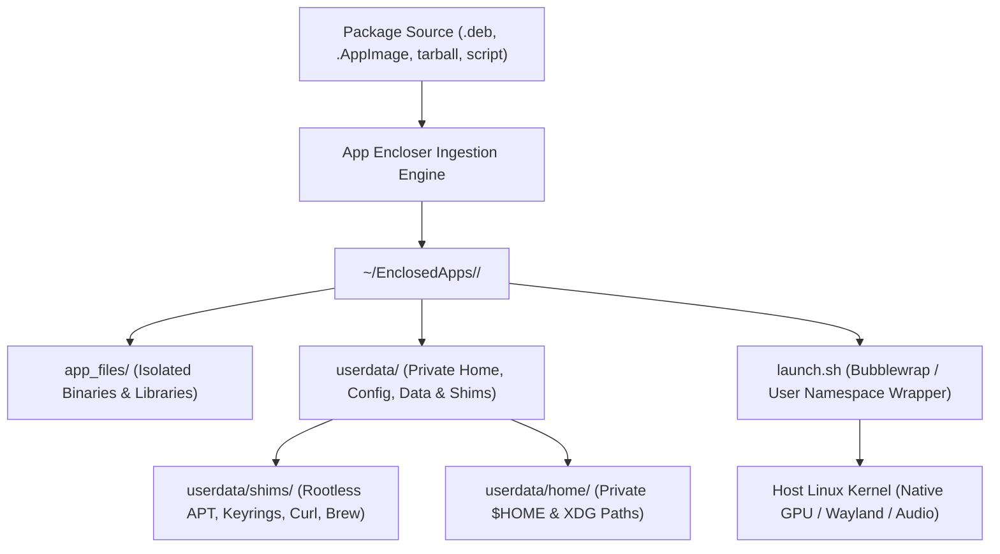

<div align="center">

# App Encloser

### Native Linux Application Sandbox, Package Encloser & Runtime Universe

[](https://ubuntu.com)
[](https://python.org)
[](https://gnome.org)
[-FF6F00?style=for-the-badge&logo=linuxcontainers&logoColor=white)](https://github.com/containers/bubblewrap)
[](https://modelcontextprotocol.io)
[](https://github.com/mdsrresad/app-encloser/actions/workflows/ci.yml)
[](LICENSE)

<br/>

**App Encloser** encapsulates **any** Linux application package (`.deb`, `.AppImage`, `.tar.gz`, `.zip`, `.rpm`, `.jar`, or arbitrary terminal install scripts) into an isolated, self-contained, portable directory inside `~/EnclosedApps/<AppName>/`.

Zero background daemons. Zero root requirement. Instant native performance. Clean application management.

</div>

> [!WARNING]
> **Security Advisory for Versions Prior to v1.0.4:**
> Releases prior to v1.0.4 contained architectural vulnerabilities (uncontained `systemd` service spawning on the host, uncontained script ingestion, and permissive user namespace bounds). All users of versions 1.0.0 through 1.0.3 must upgrade immediately to **v1.0.4+**. Versions `< 1.0.4` are deprecated and unsupported.

---

## Table of Contents

- [Overview & Why App Encloser?](#overview--why-app-encloser)
- [Comparison Matrix](#comparison-matrix)
- [Key Features](#key-features)
  - [Three Enclosing Isolation Profiles](#three-enclosing-isolation-profiles)
  - [The Container Universe Experience](#the-container-universe-experience)
  - [Terminal & AI Agent Guard](#terminal--ai-agent-guard)
  - [Automated Anomaly Detection & Self-Repair](#automated-anomaly-detection--self-repair)
  - [Built-in MCP Server for AI Coding Agents](#built-in-mcp-server-for-ai-coding-agents)
- [Directory Architecture](#directory-architecture)
- [Installation & Setup](#installation--setup)
- [Command-Line Interface (CLI)](#command-line-interface-cli)
- [Philosophy & Human Disclaimer](#philosophy--human-disclaimer)
- [Verification & Automated Tests](#verification--automated-tests)
- [Contributing](#contributing)
- [License](#license)

---

## Overview & Why App Encloser?

Linux packaging has traditionally forced users to choose between system pollution and container bloat:

1. **System Package Managers (APT, DNF):** Installing third-party PPAs, `.deb` packages, or running piped install scripts (`curl | bash`) often overwrites system shared libraries, pollutes global paths, or leaves orphaned files scattered across `/etc`, `/usr`, `/var`, and `~/.config`.
2. **Flatpak & Snap:** Require upstream maintainers to build and publish dedicated manifests. They enforce rigid runtime dependencies, consume hundreds of megabytes of duplicate base runtimes, or require root background daemons.
3. **Docker & Podman:** Designed for server services, requiring heavy base images (500MB - 2GB), complex GPU/Wayland socket forwarding hacks, and high memory overhead.

**App Encloser solves this.** It uses Linux user namespaces and **Bubblewrap** (`bwrap`) to enclose arbitrary software directly into a lightweight, portable folder.



---

## Comparison Matrix

| Feature | App Encloser | Firejail | Flatpak | Snap | Docker / Podman |
| :--- | :---: | :---: | :---: | :---: | :---: |
| **Primary Use Case** | Self-contained app directories & ingestion | Security sandboxing for existing host binaries | Application distribution & runtime sandboxing | Canonical software distribution & confinement | Service & multi-container orchestration |
| **Ingestion Format** | Direct `.deb`, tar, zip, `.AppImage`, shell script | Runs existing host binaries | Sandboxed Flathub / Flatpak manifest | Snapcraft package / store bundle | OCI Container image / Dockerfile |
| **Privilege Model** | Unprivileged Bubblewrap (`bwrap`) | SUID root or unprivileged namespaces | Bubblewrap + portals (`xdg-desktop-portal`) | AppArmor + seccomp (`snapd` root daemon) | Root daemon or rootless user namespaces |
| **Storage Architecture** | Portable folder per app (`~/EnclosedApps/`) | Standard host paths / private overlays | Centralized runtimes & `~/.var/app/` | SquashFS images & `~/snap/` | Layered image filesystem |
| **Network Lockdown** | Toggleable per app (`--no-net`) | Built-in (`--net=none`, interface isolation) | Portal-managed or network permission toggle | AppArmor / interface slot mediation | Isolated bridge / host network flags |
| **D-Bus Isolation** | Optional unbind (`--no-dbus`) | Filtered via `xdg-dbus-proxy` | Filtered via portals & `xdg-dbus-proxy` | Plugs / slots mediation | Typically unexposed |
| **Cleanup on Removal** | Wipes container directory & desktop launcher | Reverts profile bindings; leaves host files | Leaves user data in `~/.var` unless purged | Leaves snapshot revisions | Container & volume prune commands |
| **AI Agent Guard** | Built-in (interception with exit code 2) | None | None | None | None |

---

## Key Features

### Three Enclosing Isolation Profiles

App Encloser provides three configurable isolation profiles per application:

1. **Private Application Environment (Standard):**
   - Redirects `$HOME`, `$XDG_CONFIG_HOME`, `$XDG_DATA_HOME`, `$XDG_CACHE_HOME`, and `$TMPDIR` into the application's `userdata/` folder.
   - Applications access system libraries without polluting the user's home directory.
   - *Note:* This provides filesystem organization and user configuration separation, not an unprivileged kernel security boundary.
2. **Strict Sandbox (Bubblewrap Kernel Namespaces):**
   - Spawns unprivileged user namespaces via Bubblewrap (`bwrap`).
   - Mounts the host root filesystem strictly read-only (`--ro-bind / /`), protecting system binaries and configuration from unauthorized writes.
   - Masks the real host home directory with an isolated `tmpfs` layer.
   - Passes Wayland/X11 and PulseAudio/PipeWire sockets for interactive desktop integration.
   - Binds the container's directory read-write, strictly preventing modifications outside `~/EnclosedApps/<AppName>/`.
   - *Security boundary note:* Strict Sandbox enforces kernel filesystem write protection and masks `$HOME` with tmpfs. Note that network access is enabled by default (toggleable via `--no-net`). For Chromium and Electron-based applications, unprivileged nested user namespaces are restricted by the kernel, so App Encloser sets `ELECTRON_DISABLE_SANDBOX=1` and passes `--no-sandbox` to the target executable, trading internal Chromium renderer sandboxing for external Bubblewrap container containment (`--ro-bind / /`, `--unshare-pid`, etc.). Sockets for display (Wayland/X11), audio (PulseAudio/PipeWire), and D-Bus are bound read-write for desktop GUI functionality; on X11, clients lack per-window input isolation (Wayland is recommended). Requires unprivileged user namespaces enabled on the host.
3. **System Integrated:**
   - For system utilities or tools requiring direct host visibility while maintaining centralized container binary management. Runs without filesystem virtualization and directly shares host `$HOME` and user environment.

#### Modular Security Toggles (Per-Container):
Fine-tune the strict sandbox attack surface for each container individually via the CLI or UI:
- `--no-net` (or `--offline`): Disconnects network access completely (`bwrap --unshare-net`).
- `--no-display`: Isolates display server sockets; prevents Wayland/X11 and DRI rendering communication.
- `--no-dbus`: Unbinds session D-Bus sockets and system machine ID.
- `--no-sound`: Unbinds PulseAudio and PipeWire audio sockets and `/dev/snd`.

Example:
```bash
# Enforce strict sandbox with network and D-Bus completely cut off
app-encloser level MyUntrustedApp strict --no-net --no-dbus
```

---

### The Container Universe Experience

Every enclosed container acts as its own self-contained environment:

- **Interactive Shell:** Launching `app-encloser shell <app>` opens a dedicated container terminal with a custom colored prompt: `[Universe: <app>] ~$`.
- **Rootless APT & Package Extraction:** Run `sudo apt install <pkg>` or `sudo apt install <pkg>=<version>` inside the container. Package archives are downloaded and extracted into `app_files/` via `encloser-install` (using `dpkg-deb -x` rootless extraction without executing root maintainer scripts like `postinst`).
- **Rootless Keyring Redirection:** Transparently intercepts `/etc/apt/keyrings` and `/usr/share/keyrings` and routes them to `userdata/keyrings/`.
- **`encloser-python <version>`:** Download and use isolated Python versions (e.g. Python 3.10, 3.11, 3.12) inside that specific container without interfering with host Python.
- **`encloser-brew install <pkg>`:** Containerized Homebrew installation isolated in `userdata/linuxbrew/`.

---

### Terminal & AI Agent Guard

When enabled (opt-in via Settings or `app-encloser guard enable`), App Encloser configures an interceptor script (`~/.config/app-encloser/shell_guard.sh`):

- **Interactive Terminal Protection:** Intercepts package manager install commands (`apt`, `apt-get`, `pip`, `pip3`, `npm`, `uv`, `cargo`, `brew`) in interactive bash/zsh sessions, presenting an interactive menu offering to enclose the application cleanly into `~/EnclosedApps/` instead of polluting the host OS. Note: `shell_guard.sh` intercepts package manager commands, not arbitrary piped shell scripts (`curl | bash`).
- **Autonomous AI Agent Interceptor:** Non-interactive environments and AI agent processes (Claude Code, Cursor, Aider, Copilot CLI, etc.) with active detection environment variables are intercepted with **Exit Code 2** and a structured instruction message directing the agent to use `app-encloser install <pkg>`.

---

### Automated Anomaly Detection & Self-Repair

App Encloser features an automated diagnostic and self-healing engine:

- Proactively audits containers for missing or non-executable shims (`apt`, `gpg`, `curl`, `wget`, `tee`, `sudo`, `nft`, `encloser-install`, `encloser-python`, `encloser-brew`).
- Cleans dead PIDs from `running.pid`.
- Restores executable bits on `launch.sh` and regenerates damaged `.desktop` files.
- Automatically self-heals corrupted JSON configuration files (`settings.json`, `install_history.json`) by backing up `.corrupt` copies and restoring valid schemas without throwing unhandled exceptions.
- Run manually at any time via:
  ```bash
  app-encloser doctor
  ```

---

### Built-in MCP Server for AI Coding Agents

App Encloser includes a native [Model Context Protocol (MCP)](https://modelcontextprotocol.io) server implementation operating over JSON-RPC 2.0 (stdio):

```bash
app-encloser --mcp
```

AI assistants can directly inspect container states, install packages safely into isolated containers, terminate rogue processes, and query application diagnostics without root access.

---

## Directory Architecture

Enclosed applications are structured as follows:

```text
~/EnclosedApps/<AppName>/
├── app_files/          # Extracted application binaries, libraries & assets
│   ├── usr/
│   ├── opt/
│   └── etc/
├── userdata/           # Isolated user state, home, and container shims
│   ├── shims/          # Rootless shims (apt, gpg, curl, wget, tee, sudo, etc.)
│   ├── home/           # Private $HOME directory
│   ├── config/         # Private $XDG_CONFIG_HOME
│   ├── local_share/    # Private $XDG_DATA_HOME
│   ├── cache/          # Private $XDG_CACHE_HOME
│   ├── tmp/            # Private $TMPDIR
│   ├── keyrings/       # Isolated APT repository keyrings
│   ├── etc_apt/        # Isolated APT sources lists
│   ├── venv/           # Optional per-container Python virtual environment
│   └── linuxbrew/      # Optional per-container Homebrew installation
├── icon.png            # High-resolution application icon
├── <AppName>.desktop   # Local desktop launcher entry
└── launch.sh           # Container execution script (with Bubblewrap sandbox)
```

---

## Installation & Setup

### Prerequisites (Ubuntu 24.04 LTS / Debian 12+)

App Encloser is designed and tested on:
- **Ubuntu:** 24.04 LTS (Wayland / X11)
- **Debian:** 12 (Bookworm)+
- **Derivatives:** Linux Mint, Pop!_OS, Zorin OS based on Ubuntu 24.04 / Debian 12+
- **Universal Linux:** Any distribution with Python 3.10+, GTK4/Libadwaita, and Bubblewrap

Install system dependencies:

```bash
sudo apt-get update
sudo apt-get install -y \
    python3 \
    python3-gi \
    python3-gi-cairo \
    gir1.2-gtk-4.0 \
    gir1.2-adw-1 \
    bubblewrap \
    binutils \
    tar \
    gzip \
    xz-utils
```

### Option A: Install via Debian Package (.deb)

```bash
sudo dpkg -i app-encloser_1.0.9_all.deb || sudo apt-get install -f -y
```

### Option B: Build & Install from Source

```bash
git clone https://github.com/mdsrresad/app-encloser.git
cd app-encloser
./build.sh
```

The build script automatically compiles the rootless preload shim (`libencloser_shim.so`), generates the Debian package, and installs the executable into `~/.local/bin/app-encloser`.

---

## Command-Line Interface (CLI)

```bash
# Launch the GTK4 / Libadwaita graphical interface
app-encloser

# Enclose a local package, URL, or install script into a container
app-encloser install /path/to/app.deb
app-encloser install https://example.com/software.tar.gz
app-encloser install "curl -fsSL https://get.docker.com | sh"

# Install a package directly into an existing container
app-encloser install-into <AppName> <PackageName>

# Open an interactive terminal shell inside a container universe
app-encloser shell <AppName>

# Execute a command inside a container
app-encloser run <AppName> python3 --version

# Run diagnostic self-healing across all containers
app-encloser doctor

# Force stop running container processes
app-encloser kill <AppName>

# Inspect container contents, libraries, and active PIDs
app-encloser inspect <AppName>

# View or change isolation level and security toggles
app-encloser level <AppName>
app-encloser level <AppName> strict --no-net --no-dbus

# Audit all container and host installations
app-encloser audit

# Completely uninstall an application (removes container directory and desktop entries)
app-encloser uninstall <AppName>

# Manage terminal installation interceptor & host safety guard
app-encloser guard status
app-encloser guard enable
app-encloser guard disable

# Check for updates from GitHub Releases and upgrade
app-encloser check-updates
app-encloser update

# Launch the Model Context Protocol (MCP) server for AI assistants
app-encloser --mcp
```

---

## Philosophy & Human Disclaimer

App Encloser is an independent personal open-source project authored and maintained with care, designed to give Linux users full control over application isolation and host system purity.

### A Note on Human Fallibility:
> **"Never blindly believe anything."**
> I am human, and humans can make mistakes. While App Encloser is engineered to high standards with strict verification, zero speculation, and 36 automated verification checks, software interacts with complex operating system layers, diverse packaging formats, and evolving desktop environments.

- **Inspect and Verify:** Always inspect commands, verify scripts, and test in your own environment. Never execute arbitrary scripts from untrusted sources.
- **Feedback & Community:** If you discover a bug, an edge case, or an opportunity for improvement, issues and pull requests are welcomed. Every contribution helps make application isolation safer and more dependable.

---

## Verification & Automated Tests

App Encloser includes a comprehensive test suite of 36 automated verification checks (285+ assertions) covering container lifecycle, user namespace confinement, path traversal defenses (Tar symlink traversal and Zip Slip), cryptographic updater verification, and CLI/MCP interfaces:

```bash
python3 tests/verify_all.py
```

All test suites run automatically on every push and pull request. You can inspect live test runs, execution logs, and CI status directly on [GitHub Actions CI](https://github.com/mdsrresad/app-encloser/actions/workflows/ci.yml).

---

## Contributing

Contributions, bug reports, and feature requests are welcome! Please check out [CONTRIBUTING.md](CONTRIBUTING.md) for guidelines on development and submitting pull requests.

---

## License

This project is licensed under the **MIT License**. See the [LICENSE](LICENSE) file for complete details.
